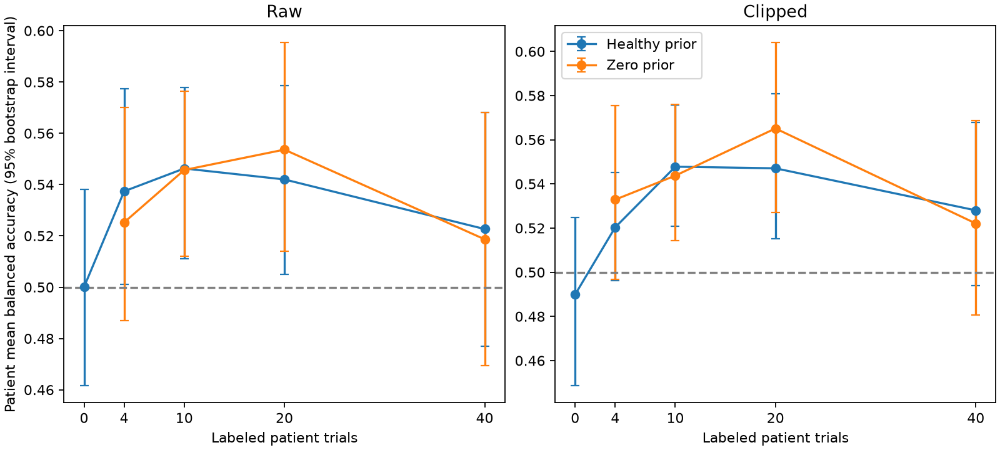
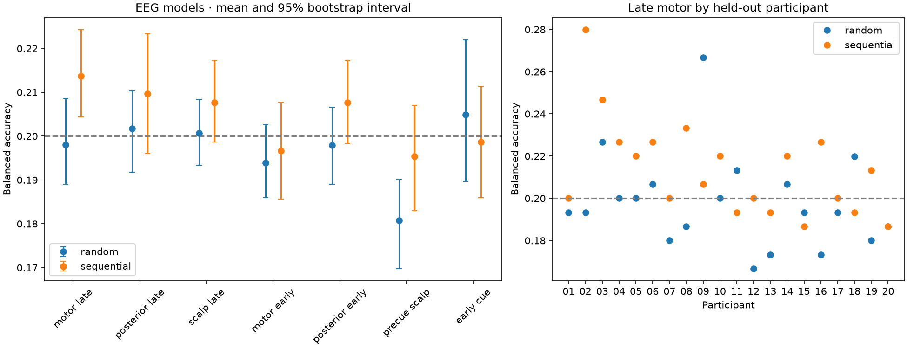

# EEG Transfer Benchmarks

Two exploratory Python benchmarks ask which EEG motor-task signals transfer across people, how much a few labeled patient trials help, and whether cues or trial order can explain apparent decoding. The project implements data and event audits, participant-held-out evaluations, and calibration and control comparisons on public recordings.

## Results

| Benchmark | Cohort | Primary result | Comparison |
| --- | --- | --- | --- |
| Healthy-to-stroke pinch vs. fist | 8 healthy controls, 10 baseline stroke participants, 2,430 trials | **50.0%** zero-shot balanced accuracy (46.2–53.8%) | **54.6%** with 10 labeled patient trials under either coefficient prior after rounding. The paired gain with the healthy prior was +4.6 percentage points (−1.4 to +9.7). [Clinical summary](results/clinical_cohort/paired_summary.csv) |
| Cross-participant five-finger imagery | 20 participants, 80 runs, 5,981 complete trials | **19.8%** late motor balanced accuracy on random-order runs (18.9–20.9%, nominal chance 20%) | Late posterior features scored 20.2%. Sequential late motor EEG scored 21.4%, while either no-EEG order diagnostic scored 100%. [Digit summary](results/digit_cohort/summary.csv) |

Scores are participant means. Intervals are descriptive 95% participant-bootstrap intervals. Dataset B includes 2,981 random and 3,000 sequential trials.



**Patient calibration.** All budgets use the same 685 later test trials across ten patients. Clipped zero-shot motor accuracy was 49.0%, versus 50.0% for raw EEG. The healthy prior had no consistent advantage. [Feature and cue controls](results/clinical_cohort/features.png)



**Five-finger EEG.** Random order is the primary comparison. The plot shows EEG models only. Run slot plus trial position and the previous true cue gave 22.4% and 23.1% on random runs, respectively, and 100% each on sequential runs without EEG. The previous-cue diagnostic uses the preceding true label. [Confusion matrices](results/digit_cohort/confusion.png) · [Cue-relative mu/beta power](results/digit_cohort/erd.png)

## Methods and failure modes

- **Signal and models.** MNE reads BrainVision and EDF and supplies trial windows. Trial-local Hann periodograms estimate log mu (8–12 Hz) and beta (12–30 Hz) power. The EEG models use L2-regularized logistic regression with weighted standardization fitted on training participants. Early cue amplitude, pre-cue power and, in Dataset A, bipolar EOG provide nonmotor comparisons.
- **Dataset A.** The clinical group column incorrectly assigns every participant to stroke. Cohort assignments use verified recording provenance. BrainVision cue codes agree with BIDS text labels and timing, while BIDS numeric values are reversed. Motor features use 0.5–1.5 s after cue onset, before the recorded go cue. Patient calibration uses class-balanced labels from the chronological first half, one guard trial, and later trials for testing. Grip and cue-image identity coincide. Early visual features reached 51.6% raw zero shot, leaving motor specificity unresolved.
- **Dataset B.** Random and sequential runs use separate leave-one-participant-out fits. Corrected event timing matched the EDF marker stream in all 80 runs. The marker and reference channels are excluded from EEG features. The highlighted digit reveals the label, and the recording does not independently establish display offset. Order diagnostics expose shortcuts even in the random runs. These results provide no convincing motor-specific cross-participant transfer under this baseline.
- **Electrode grouping.** Both benchmarks compare fixed 15-electrode motor-centered groups with size-matched nonmotor or posterior groups and whole-scalp features. Dataset A also concatenates motor bandpower with visual and ocular features. Dataset B compares cue-relative power over motor and posterior sensors. All analyses operate in sensor space. Cortical source localization, anatomical parcellation and validated interregional connectivity modeling were not implemented.

The clinical analysis covers baseline recordings only. Both cohort analyses include participants from their respective pilots, and the clinical pilot informed the cohort design. The benchmarks leave acquisition effects, cue-related activity and weak or variable motor information as competing explanations.

## Reproduce

**Inspect saved scores.** The linked aggregate tables and figures require no dataset download. A local workspace with cached trial predictions can recompute headline scores by calculating mean class recall per participant and then averaging participants. The release excludes the trial predictions and has no separate scoring CLI. The [release manifest](PUBLIC_RELEASE_MANIFEST.md#saved-run-provenance) identifies the saved full run records and dataset pins.

**Run the full pipeline.** From the repository root, use Python 3.12 (saved runs used 3.12.14). The commands below use PowerShell. The loaders fetch approximately **3.73 GB** for Dataset A and **5.76 GB** plus a small stimulus set for Dataset B. After acquisition, the analysis commands can run offline. Separate output directories preserve the included results.

```powershell
python -m venv .venv
$py = ".\.venv\Scripts\python.exe"
& $py -m pip install -r requirements.txt
$env:OPENBLAS_NUM_THREADS = "1"
$env:OMP_NUM_THREADS = "1"

& $py clinical_data.py --cohort
& $py clinical_cohort.py --output results/reproduction/clinical_cohort

& $py digit_data.py --stimuli-only
& $py digit_data.py --cohort
& $py digit_benchmark.py --cohort --output results/reproduction/digit_cohort
```

Each analysis writes `run.json`, summary tables, trial predictions and figures to its output directory. The [clinical design](cohort_design.md) and [five-finger design](digit_design.md) document the splits and controls. The existing offline regression suite runs with `& $py -m unittest -v test_digit_benchmark`. It uses synthetic fixtures, including a small classifier-fit test for participant isolation.

## Data credits and licenses

- **Dataset A.** Pardo-Garcia et al., *Mu/beta motor-imagery EEG in chronic MCA stroke and healthy controls*, NEMAR `nm000309` v1.0.1. The included aggregate tables and plots are analyses of the source data, with cohort and cue mappings checked as described above. [Dataset and citation](https://nemar.org/dataset/nm000309?v=v1.0.1) · [CC BY 4.0](https://creativecommons.org/licenses/by/4.0/)
- **Dataset B.** Damm, Jiang and Demosthenous, *Random and Sequential Order Finger Motor Imagery*, OpenNeuro `ds008446` v1.0.1. The timing correction follows the documented Damm2026 loader convention. [Dataset DOI](https://doi.org/10.18112/openneuro.ds008446.v1.0.1) · [CC0](https://creativecommons.org/publicdomain/zero/1.0/) · [Timing correction](https://moabb.neurotechx.com/docs/generated/moabb.datasets.Damm2026.html)
- The proposed [MIT license](LICENSE) applies to repository code. Dataset terms apply separately, and raw datasets are acquired from the sources above.
